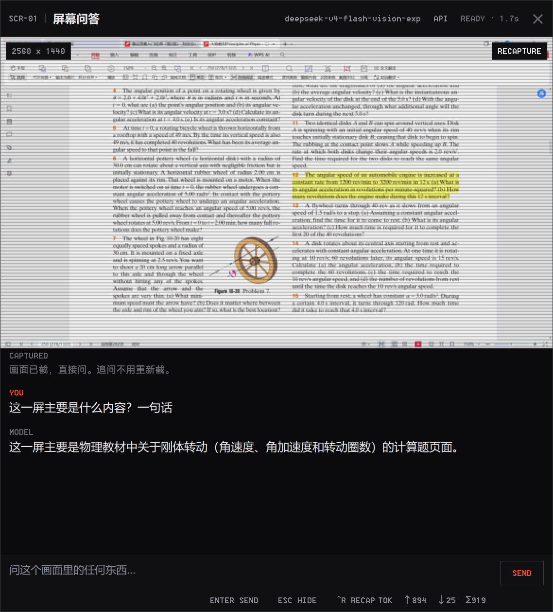
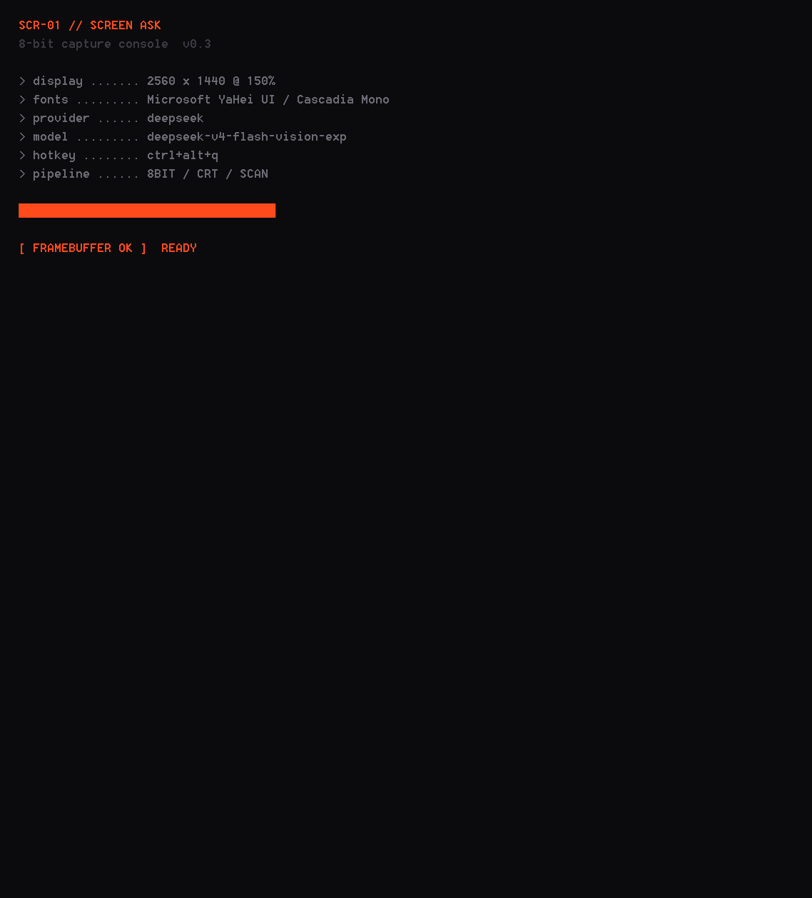

# Screen Ask

按一次热键，截下整个屏幕，直接问视觉模型 —— 不用切窗口、不用存文件、不用上传。



启动时是一段 8-bit 终端自检，逐行打出当前配置：



## 它解决什么

看视频、读 PDF、盯报错、做实验，遇到「这是什么 / 这里为什么错 / 这个字念什么」的时候，
正常流程是：截屏 → 打开某个聊天窗口 → 粘贴 → 打字 → 等回复。
Screen Ask 把它压成一步：**按热键，浮窗已经在截图上方，直接打字问。**

## 特性

- **一键盘唤出**：默认 `Ctrl+Alt+Q`，再按一次收起
- **多轮追问**：截图只发一次，后续问题复用同一张图，省 token
- **两种后端**：云端 DeepSeek / 本地 Ollama（qwen2.5vl 等），界面上随时切换
- **大图查看器**：点缩略图放大，滚轮缩放（5%–1000%，以鼠标为锚点）、拖动平移、双击回自适应
- **界面内配置 API**：顶栏 `API` → 填 Provider / Model / Base URL / Key → 写回本机 `.env`
- **零界面框架**：tkinter 手绘面板，直角 + 1px 细线 + 单色信号红，没有圆角卡片和渐变
- **8-bit 渲染**：截图先降到 1/2 分辨率再用 NEAREST 放回 —— 硬边像素块，不是模糊缩放；叠加 CRT 扫描线（每 3 行一条，缓慢下移）
- **点阵字体**：标签走系统点阵字体（Windows `Terminal`，8×12 原生像素），只有 12px 才不被抗锯齿；缺失的平台退回等宽字体
- **实时 token 计数**：输入区右下角 `TOK ↑894 ↓66 Σ960` —— 流式时只报已收字符估算（红色，不编造输入数），收到 API 的 `usage` 后替换为精确值；`Σ` 是本次会话累计
- **开机自检动画**：无边框 splash，逐行打出分辨率 / 字体 / provider / model / 热键，进度条扫完收起
- **抓屏入场**：新截图不是直接贴上，而是从上往下逐行扫出（430ms），扫描光束是信号红
- **DPI 感知**：150% / 200% 缩放下不会糊，窗口尺寸按屏幕比例自适应

## 安装

需要 Python 3.9+（自带 tkinter）和一个能截图的桌面会话。

```bash
git clone <this-repo>
cd screen-ask
pip install -r requirements.txt      # 只有 Pillow
cp .env.example .env                 # 然后填入你的 API Key
python screen_ask.py
```

Windows 想让它不带黑色控制台窗口：

```bat
start.bat
```

## 配置

三种方式，优先级从低到高：

1. 项目目录 `.env`（参考 `.env.example`）
2. 用户配置 `~/.screen-ask/.env`（界面里点 APPLY 默认写这里，不污染仓库）
3. 环境变量 `SA_*` / `DEEPSEEK_*` / `OLLAMA_*`

| 键 | 说明 | 默认 |
| --- | --- | --- |
| `SA_PROVIDER` | `deepseek` 或 `ollama` | `deepseek` |
| `DEEPSEEK_API_KEY` | DeepSeek API Key | — |
| `SA_DEEPSEEK_BASE` | API 地址（可换中转/自建） | `https://api.deepseek.com` |
| `SA_DEEPSEEK_MODEL` | 支持图片输入的模型名 | `deepseek-v4-flash-vision-exp` |
| `OLLAMA_URL` | 本地 Ollama 地址 | `http://127.0.0.1:11434` |
| `SA_OLLAMA_MODEL` | 本地视觉模型 | `qwen2.5vl:7b` |
| `SA_HOTKEY` | 热键 | `ctrl+alt+q` |
| `SCREEN_ASK_HOME` | 用户目录（存 `.env` 和 `run.log`） | `~/.screen-ask` |

本地模型路线：

```bash
ollama pull qwen2.5vl:7b
# 然后把 SA_PROVIDER 改成 ollama，或界面里点 OLLAMA 标签
```

7B 在 8GB 显存上约 2–3 秒出一屏；3B 版本对 1600px 截图容易输出乱码，不建议。

## 快捷键

| 键 | 动作 |
| --- | --- |
| `Ctrl+Alt+Q` | 唤出 / 收起（重新截图） |
| `Enter` | 发送 |
| `Shift+Enter` | 换行 |
| `Esc` | 关面板 → 收起窗口 |
| `Ctrl+R` | 重新截图 |
| 查看器中滚轮 / 拖动 / 双击 | 缩放 / 平移 / 回自适应 |

## 平台支持

| | Windows | macOS | Linux |
| --- | --- | --- | --- |
| 截图 | ✅ 全屏（多显示器） | ⚠️ 需屏幕录制授权 | ⚠️ 需 X11 |
| 全局热键 | ✅ 原生 `RegisterHotKey` | ⚠️ 需 `pip install keyboard` + 辅助功能授权 | ⚠️ 同上，且常需 root |
| 无边框窗口 | ✅ | ⚠️ 保留系统标题栏（否则收不到键盘） | ✅ |
| DPI 缩放 | ✅ 逐显示器感知 | ✅ 系统管理 | ✅ 系统管理 |

Windows 是主路径，其余平台可用但有降级。非 Windows 上如果热键注册失败，顶栏会显示 `NO HOTKEY`，界面本身仍可用（启动时自动截图一次）。

## 隐私

- 截图只发给你自己配置的后端（DeepSeek API 或本机 Ollama），不发往任何第三方。
- 图片在内存里降采样到 1600px、JPEG 质量 78 再 base64，不写磁盘。
- API Key 只存在本机 `.env`，界面里以掩码显示，不会打印到日志。
- `run.log` 只记时间戳、provider、模型名和错误摘要。

## 已知限制

- 单屏截图会被压缩到 1600px 长边，极小字号可能看不清 —— 这是速度与精度的取舍。
- 追问时不再重发图片，只发文本，所以追问不能指向「画面里另一个区域」。
- 不做 OCR 兜底，纯靠模型视觉能力。

## License

MIT
